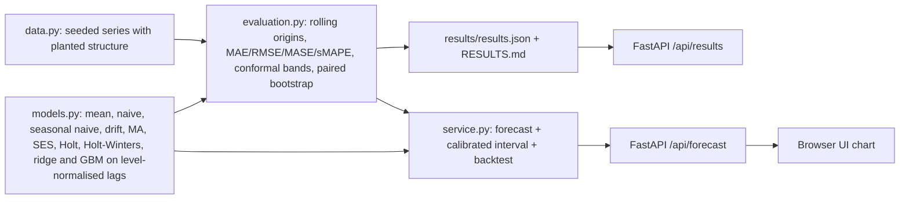

# Architecture

Author: Rayyan Anwar

## Protocol
Expanding-window rolling origins: for origin t the model sees only `y[:t]` and forecasts `y[t:t+h]`. The first origin is at least half the series; 8 to 12 origins are spread evenly. Metrics are averaged over origins and horizons. MASE divides MAE by the in-sample seasonal-naive MAE (naive when there is no season). A test corrupts every value after each origin and checks that forecasts do not change.

## Models
Exponential smoothing parameters (alpha, beta, gamma) are fitted by minimising one-step SSE with L-BFGS-B inside each origin's training window. Lag regression uses windows of `2m` lags (at least 5), each normalised by subtracting its own mean so that level and trend do not need to be extrapolated by the learner; multi-step forecasts are recursive.

## Intervals
Split-conformal style per horizon: absolute errors of the same model at past origins give a quantile (finite-sample corrected); forecast +/- that quantile. Coverage is measured out of sample by calibrating on the first half of origins and testing on the second.
